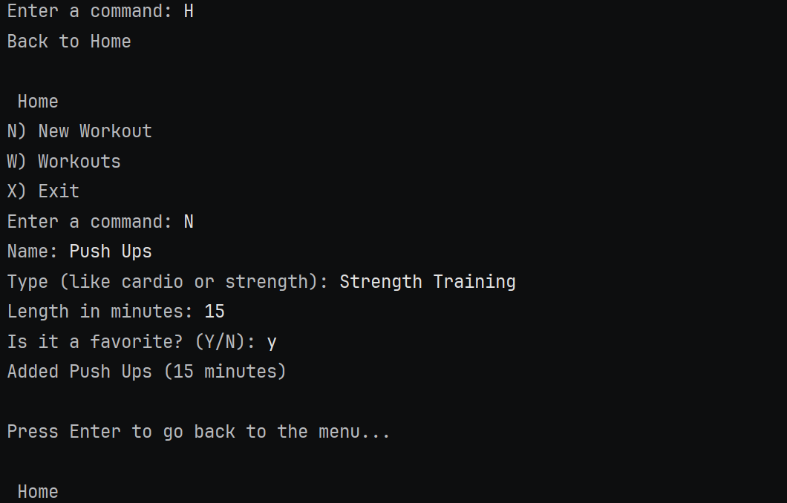
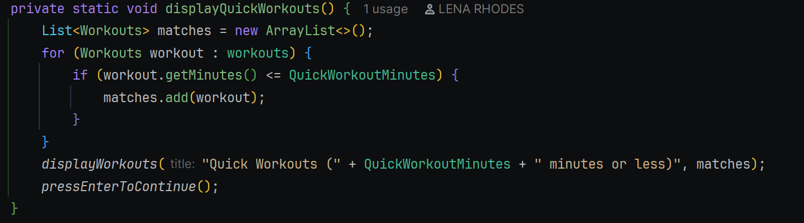

# Workout Tracker

A command-line app for someone who exercises and wants to keep track of their workouts. The app remembers every workout you add in a list while it is running, so the Workouts screens and searches show real results. The list starts empty each time the app starts, because nothing is saved to a file yet.

### Features
- Add a workout with a name, a type, its length in minutes, and whether it is a favorite; it is kept in memory while the app runs
- Look through workouts: all of them, quick ones (30 minutes or less), or favorites
- Search workouts by name, by type (like cardio or strength), or by how much time you have
- Every list has a count underneath, and a friendly "No workouts found." when nothing matches
- Typing a wrong letter shows a friendly message and the same menu again
- Typing letters where a number is expected asks again instead of crashing

### How to run it
1. Clone the repository and open it in IntelliJ
2. Run WorkoutTrackerApp.java (it uses Workouts.java, in the same folder)
3. Type a letter from the menu, like n to add a workout or w to see your workouts

### Screenshots

The app's memory is a list. Adding a workout puts it in the list, and every other screen finds workouts by going through that list. Each screen is the same loop: look at every workout, and keep only the ones that match.

### Interesting code

Favorites and the three searches use the same loop with a different if. Quick Workouts only changes the condition. One method, displayWorkouts, prints any list, so the table and the count look the same on every screen.

Typing abc where a number is expected would crash a plain Integer.parseInt. This helper keeps asking until the user types a whole number:

Author

Lena Rhodes Java Academy